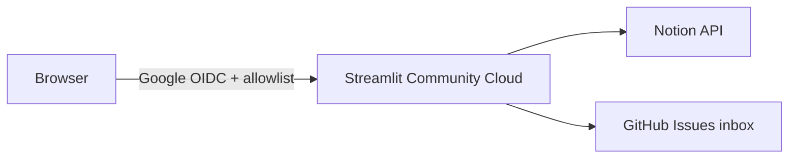

# Household deploy (Streamlit Community Cloud)

Locked requirements for [#354](https://github.com/rachelgramlich/grocery-wizard/issues/354): household-only access, **Google allowlist**, **Notion secrets server-side**, and **GitHub feedback inbox** (label `user-feedback-inbox`). Triage inbox issues with follow-up [#355](https://github.com/rachelgramlich/grocery-wizard/issues/355).

## Architecture

## One-time setup

### 1. Google OAuth (app-level allowlist)

1. Create a Google Cloud OAuth client (Web application) per [Streamlit’s Google auth tutorial](https://docs.streamlit.io/develop/tutorials/authentication/google).
2. Add authorized redirect URI: `https://<your-app>.streamlit.app/oauth2callback` (and `http://localhost:8501/oauth2callback` for local auth testing).
3. Add test users on the OAuth consent screen while status is **Testing** (household emails).

### 2. Streamlit Community Cloud app

1. Connect the GitHub repo; set **Main file path** to `src/grocery_wizard/ui/app.py`.
2. Set the app to **Private** and optionally add viewers in Cloud sharing (belt-and-suspenders with in-app allowlist).
3. Paste **Secrets** (TOML) — same shape as committed `secrets.toml.example` at repo root:

| Secret / env | Purpose |
| --- | --- |
| `NOTION_*` | Same as `.env.example` |
| `[auth]` block | Google OIDC (`client_id`, `client_secret`, `redirect_uri`, `cookie_secret`, `server_metadata_url`) |
| `GROCERY_WIZARD_REQUIRE_AUTH` | `true` |
| `GROCERY_WIZARD_AUTH_EMAIL_ALLOWLIST` | Comma-separated household Google emails |
| `GITHUB_FEEDBACK_REPOSITORY` | `rachelgramlich/grocery-wizard` (default if omitted) |
| `GITHUB_FEEDBACK_TOKEN` | Fine-grained PAT, **issues:write** on this repo only |

Never bake tokens into the Docker image or commit them to git.

**Local parity:** copy [`secrets.toml.example`](../secrets.toml.example) to **`secrets.toml`** at repo root (gitignored). Run **`just link-secrets`** so Streamlit sees `[auth]` via `.streamlit/secrets.toml` → `../secrets.toml`. `load_config()` reads the root file before `.env`. Precedence: **shell environment → secrets.toml → `.env`**.

**Google login (`st.login`):** depends on **`streamlit[auth]`** (Authlib + httpx). After `git pull`, run **`just setup`** or **`uv sync`** so your venv matches `pyproject.toml`.

### 3. GitHub feedback PAT (fine-grained, production)

Production **Send feedback** must use a **fine-grained** personal access token scoped to this repo—not a broad classic token or a copy of `gh auth token` from local dev ([#360](https://github.com/rachelgramlich/grocery-wizard/issues/360)).

#### Create the token (GitHub)

1. GitHub → **Settings** → **Developer settings** → **Personal access tokens** → **Fine-grained tokens** → **Generate new token**.
2. **Resource owner:** your account (or org that owns the repo).
3. **Repository access:** **Only select repositories** → `rachelgramlich/grocery-wizard`.
4. **Permissions** (repository): **Issues** → **Read and write** only. Leave Contents, Actions, and other permissions at **No access**.
5. Set a short **expiration** (e.g. 90 days) and a note such as `grocery-wizard Streamlit feedback`.
6. **Generate** and copy the token once (`github_pat_…`). You cannot view it again.

Do **not** commit the token or bake it into a Docker image.

#### Install in Streamlit Community Cloud

1. Open the app in [Streamlit Community Cloud](https://share.streamlit.io/) → **Manage app** → **Settings** → **Secrets**.
2. Edit the existing TOML (same shape as [`secrets.toml.example`](../secrets.toml.example)). Set or replace:

   `GITHUB_FEEDBACK_TOKEN = "github_pat_…"`

   Keep `GITHUB_FEEDBACK_REPOSITORY = "rachelgramlich/grocery-wizard"` unless you intentionally file elsewhere.
3. **Save** → **Reboot app** (Secrets changes do not apply until reboot).

#### Verify

1. Sign in on the production URL (allowlisted Google account).
2. Expand **Send feedback**, submit a short test note, confirm success toast.
3. On This Mac: `gh issue list --label user-feedback-inbox --state open --repo rachelgramlich/grocery-wizard` — confirm the new inbox issue.

#### Revoke old tokens

If you ever pasted a **classic** PAT, a **`gh auth token`**, or an over-scoped token into Cloud Secrets:

1. After the fine-grained token works, open **GitHub → Settings → Developer settings → Personal access tokens** (fine-grained **and** classic lists).
2. **Revoke** the old token(s) used for Cloud feedback.
3. Local dev can keep using `gh auth login` for issues/PRs; that CLI token must **not** be copied into Streamlit Secrets.

Submitted notes open issues labeled **`user-feedback-inbox`**. Promote to backlog label `grocery-wizard` after triage ([#355](https://github.com/rachelgramlich/grocery-wizard/issues/355)).

### Secret rotation (no git commits)

All deploy secrets live in **Streamlit Community Cloud → Manage app → Settings → Secrets** (TOML). Rotating a key never requires a repo commit—only edit Secrets and **Reboot app**.

| Secret | When to rotate | Steps |
| --- | --- | --- |
| **`NOTION_API_KEY`** | Notion integration secret rolled, suspected leak, or offboarding | Create/roll secret in [Notion integrations](https://www.notion.so/my-integrations). Paste new `NOTION_API_KEY` in Cloud Secrets (other `NOTION_*` IDs unchanged unless you migrated DBs). Save → Reboot. Smoke-test one Notion read; revert any test write in Notion. |
| **`GITHUB_FEEDBACK_TOKEN`** | Expiration, suspected leak, or PAT policy | Generate a **new** fine-grained PAT (Issues read/write on this repo only). Replace `GITHUB_FEEDBACK_TOKEN` in Cloud Secrets → Save → Reboot. Submit test **Send feedback**; confirm inbox issue. **Revoke** the previous PAT in GitHub. |
| **`[auth]`** (`client_secret`, `cookie_secret`) | Google OAuth client rotated or cookie compromise | Update values in Google Cloud Console and Cloud Secrets TOML (`[auth]` block + matching **Authorized redirect URIs**). Save → Reboot. Sign-in smoke from a second device. |
| **NYT cookies** (`NYT_S_COOKIE`, `NYT_REGI_ID`) | Sync stops working (phase 6) | Refresh cookies locally, paste into Cloud Secrets → Reboot. |

If **Send feedback** fails after rotation, check **Manage app → Logs** for configuration warnings (missing `GITHUB_FEEDBACK_TOKEN` when auth is enabled) and the troubleshooting table below.

## Local vs deployed

| Setting | Local (`just grocery-ui`) | Household Cloud |
| --- | --- | --- |
| `GROCERY_WIZARD_REQUIRE_AUTH` | `false` in `.streamlit/secrets.toml` | `true` |
| Feedback | Always GitHub (`user-feedback-inbox`) | Same |
| Feedback triage | #355 inbox command or `gh issue list --label user-feedback-inbox` | Same |

## Manual smoke test (after deploy)

1. From a device that is **not** your dev laptop, open the HTTPS app URL.
2. Confirm Google sign-in is required and non-allowlisted accounts are rejected.
3. Load **Create weekly plan** (Notion read) and perform one reversible write (e.g. pantry tweak); **revert** in Notion.
4. Submit **Send feedback**; confirm a new GitHub issue with label `user-feedback-inbox`.
5. In browser DevTools → Network, confirm no `NOTION_*` or `GITHUB_*` values appear in responses.

### Streamlit Community Cloud — deploy UI

- **Create app** → **“Yup, I have an app”** (do **not** use the template / “create a repository” path).
- Repository: **`rachelgramlich/grocery-wizard`**, branch **`main`**, file **`src/grocery_wizard/ui/app.py`**.
- Private repo: grant Community Cloud access to **private** repos in account settings, or **Paste GitHub URL** to the entrypoint file on GitHub.
- **Custom subdomain** (e.g. `grocerywizard.streamlit.app`) only changes the public URL — not a new GitHub repo.

### Google OAuth — production redirect

Register **both** in the Google Cloud OAuth client (**Authorized redirect URIs**):

- `http://localhost:8501/oauth2callback` (local)
- `https://<your-subdomain>.streamlit.app/oauth2callback` (must match **`[auth].redirect_uri`** in Cloud Secrets exactly)

On the OAuth **consent screen**, add authorized domain **`streamlit.app`**. Keep household emails as **Test users** while the app is in Testing.

## Post-setup (phases 4–6)

| Phase | Topic | Tracking |
| --- | --- | --- |
| **4** | Fine-grained **GitHub feedback PAT** in Cloud Secrets + rotation runbook | [#360](https://github.com/rachelgramlich/grocery-wizard/issues/360) (this doc, §3 and **Secret rotation**) |
| **5** | Triage **`user-feedback-inbox`** → **`grocery-wizard`** backlog | [#355](https://github.com/rachelgramlich/grocery-wizard/issues/355) (`/promote-feedback-inbox` or similar) |
| **6** | Optional **NYT Cooking** sync on hosted app (`NYT_S_COOKIE`, `NYT_REGI_ID` in Cloud Secrets; cookies expire) | GitHub issue (backlog) |

List inbox issues: `gh issue list --label user-feedback-inbox --state open --repo rachelgramlich/grocery-wizard`

## Troubleshooting

| Symptom | Likely cause | Fix |
| --- | --- | --- |
| Google “doesn't comply with OAuth 2.0 policy” / redirect | Prod URI not registered | Add `https://….streamlit.app/oauth2callback` in Google **and** Cloud `[auth].redirect_uri` |
| `StreamlitMissingAuthlibError` | Missing `streamlit[auth]` deps | `uv sync` / `just setup` on `main` (see #359) |
| Feedback `GITHUB_FEEDBACK_TOKEN` | Missing or revoked token | Update Cloud Secrets; prefer fine-grained PAT (phase 4) |
| **`ValidationError` after reboot** | Cloud Secrets missing/invalid TOML, or bool/env mismatch | **Manage app → Logs** for field names. Re-paste Secrets (TOML, not `.env` syntax). Need all `NOTION_*`, flat keys + `[auth]`. Save → Reboot. |
| Notion key missing locally | No `secrets.toml` | Copy `secrets.toml.example` → `secrets.toml`; `just link-secrets` |
| App auth OK but “not authorized” | Email not on allowlist | `GROCERY_WIZARD_AUTH_EMAIL_ALLOWLIST` in secrets |
| **My apps** title **“Sign in – Google Accounts”** | SCC profile tile uses **OAuth page title + screenshot**; Settings has **App URL** only (no display-name field) | Expected for **auth-gated** apps. Ignore for household use, or share **`grocerywizard.streamlit.app`** directly. Optional: custom subdomain in Settings → General (still won’t fix Google title on the tile). |
| **My apps** shows error screenshot + sidebar (`app`, `add recipe`, …) | Crash on startup **or** Streamlit treating `pages/` as multipage | Fix **ValidationError** in logs (Secrets TOML). On `main`, UI modules live under `ui/views/` (not `ui/pages/`) so Cloud does not register extra pages. |
| No README blurb on profile card | SCC card is mostly **name + screenshot**; README summary helps link previews and GitHub | Merge README on `main`, fix Secrets, reboot; optional **public** app for gallery-style listings |

## Staging Notion

**Deferred** — [#356](https://github.com/rachelgramlich/grocery-wizard/issues/356). Household MVP uses one production Notion integration; revert test writes per `AGENTS.md` UAT rules.
