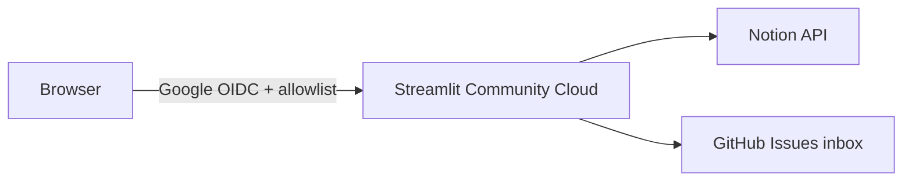

# Household deploy (Streamlit Community Cloud)

Locked requirements for [#354](https://github.com/rachelgramlich/grocery-wizard/issues/354): household-only access, **Google allowlist**, **Notion secrets server-side**, and **GitHub feedback inbox** (label `user-feedback-inbox`). Triage inbox issues with follow-up [#355](https://github.com/rachelgramlich/grocery-wizard/issues/355).

## Architecture

## One-time setup

### 1. Google OAuth (app-level allowlist)

1. Create a Google Cloud OAuth client (Web application) per [Streamlit’s Google auth tutorial](https://docs.streamlit.io/develop/tutorials/authentication/google).
2. Add authorized redirect URI: `https://<your-app>.streamlit.app/oauth2callback` (and `http://localhost:8501/oauth2callback` for local auth testing).
3. Add test users on the OAuth consent screen while status is **Testing** (household emails).

### 2. Streamlit Community Cloud app

1. Connect the GitHub repo; set **Main file path** to `src/grocery_wizard/ui/app.py`.
2. Set the app to **Private** and optionally add viewers in Cloud sharing (belt-and-suspenders with in-app allowlist).
3. Paste **Secrets** (TOML) — same shape as committed `secrets.toml.example` at repo root:

| Secret / env | Purpose |
| --- | --- |
| `NOTION_*` | Same as `.env.example` |
| `[auth]` block | Google OIDC (`client_id`, `client_secret`, `redirect_uri`, `cookie_secret`, `server_metadata_url`) |
| `GROCERY_WIZARD_REQUIRE_AUTH` | `true` |
| `GROCERY_WIZARD_AUTH_EMAIL_ALLOWLIST` | Comma-separated household Google emails |
| `GITHUB_FEEDBACK_REPOSITORY` | `rachelgramlich/grocery-wizard` (default if omitted) |
| `GITHUB_FEEDBACK_TOKEN` | Fine-grained PAT, **issues:write** on this repo only |

Never bake tokens into the Docker image or commit them to git.

**Local parity:** copy [`secrets.toml.example`](../secrets.toml.example) to **`secrets.toml`** at repo root (gitignored). Run **`just link-secrets`** so Streamlit sees `[auth]` via `.streamlit/secrets.toml` → `../secrets.toml`. `load_config()` reads the root file before `.env`. Precedence: **shell environment → secrets.toml → `.env`**.

**Google login (`st.login`):** depends on **`streamlit[auth]`** (Authlib + httpx). After `git pull`, run **`just setup`** or **`uv sync`** so your venv matches `pyproject.toml`.

### 3. GitHub feedback PAT

- Fine-grained personal access token scoped to this repository.
- Permission: **Issues** → Read and write.
- Store only in Streamlit Cloud secrets (or host env).

Submitted notes open issues labeled **`user-feedback-inbox`**. Promote to backlog label `grocery-wizard` after triage ([#355](https://github.com/rachelgramlich/grocery-wizard/issues/355)).

## Local vs deployed

| Setting | Local (`just grocery-ui`) | Household Cloud |
| --- | --- | --- |
| `GROCERY_WIZARD_REQUIRE_AUTH` | `false` in `.streamlit/secrets.toml` | `true` |
| Feedback | Always GitHub (`user-feedback-inbox`) | Same |
| Feedback triage | #355 inbox command or `gh issue list --label user-feedback-inbox` | Same |

## Manual smoke test (after deploy)

1. From a device that is **not** your dev laptop, open the HTTPS app URL.
2. Confirm Google sign-in is required and non-allowlisted accounts are rejected.
3. Load **Create weekly plan** (Notion read) and perform one reversible write (e.g. pantry tweak); **revert** in Notion.
4. Submit **Send feedback**; confirm a new GitHub issue with label `user-feedback-inbox`.
5. In browser DevTools → Network, confirm no `NOTION_*` or `GITHUB_*` values appear in responses.

## Staging Notion

**Deferred** for household MVP — single production Notion integration; revert test writes per `AGENTS.md` UAT rules.
